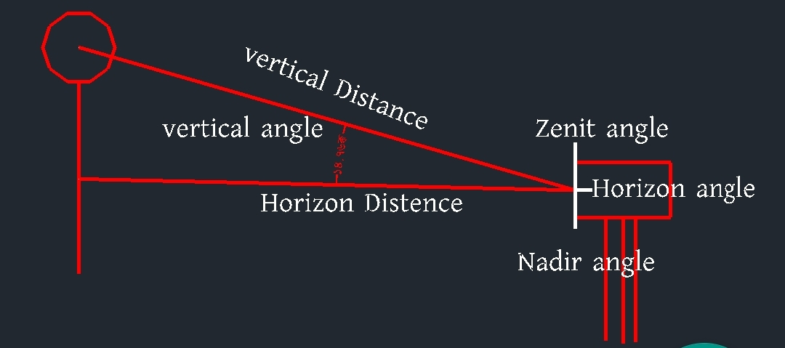

# How to use Tutalstation Basic

(1) Zenith angle জান্তে হবে

(২) Nadir Angle জান্তে হবে

(৩) Horizantol Angle জান্তে হবে

(৪) Vertical angle জান্তে হবে ( মূল জিনিস এটা)

(৫) azimat angle [ Noth লাইন ঠিক রেখে Bearing এর মতো ডাইন সাইট যাওয়াকে বলে ]
## distance Basic

(1) Horizantol distans জান্তে হবে

(2) Vertical ই হলো slop distance  জান্তে হবে ( মূল জিনিস এটা)

## Basik

Horizantal Distance= Northing

## টোটাল স্টেশন মেশিন শিখা

(1) Job creat

(2) OBS= obser Bition
শুদু Northin distancs এর জন্য = Horizantal Distance

Horizantal Angla = o set করতে হবে 

(3) occ.= orian tation [ প্রথম যেখানে মেশিন আছে ঐখানে N= 1000.000,E= 1000.000, HI= মেশিন হাইট দিতে হবে।

(4) CD [ back side নাম লিখতে হবে।]
name = ST26

(৫) পরে BAZ= backsid Any Z

(৬) N= 1038.535,E= 1000.000, HR = পিজমের হাইট দিতে হবে। 

(৭) yes দিতে হবে

(৮) obser Bition মোডে আবার যাবো
maser করে দেখবু ঠিক আছে কিনা backsid. 

<!--[profile](./r.jpg)-->

