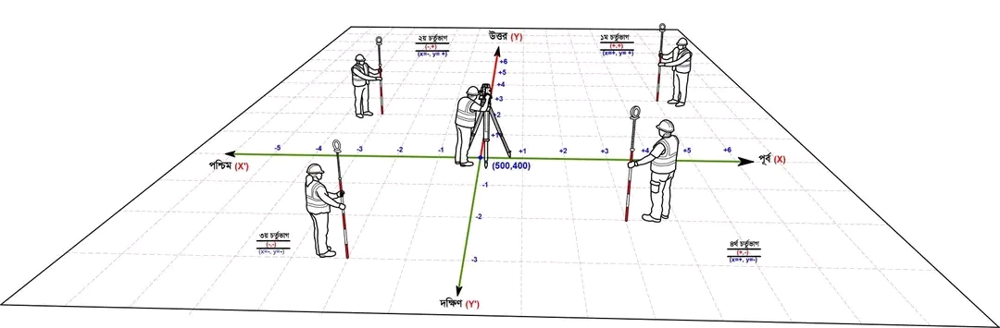

# How to use Tutalstation Basic

(1) Zenith angle জান্তে হবে

(২) Nadir Angle জান্তে হবে

(৩) Horizantol Angle জান্তে হবে

(৪) Vertical angle জান্তে হবে ( মূল জিনিস এটা)

(৫) azimat angle [ Noth লাইন ঠিক রেখে Bearing এর মতো ডাইন সাইট যাওয়াকে বলে ]
## distance Basic

(1) Horizantol distans জান্তে হবে

(2) Vertical ই হলো slop distance  জান্তে হবে ( মূল জিনিস এটা)

## Basik

Horizantal Distance= Northing

## টোটাল স্টেশন মেশিন শিখা

(1) Job creat

(2) OBS= obser Bition
শুদু Northin distancs এর জন্য = Horizantal Distance

(2) Horizantal Angla = o set করতে হবে 

(3) occ.= orian tation [ প্রথম যেখানে মেশিন আছে ঐখানে N= 1000.000,E= 1000.000, HI= মেশিন হাইট দিতে হবে।

(4) CD [ back side নাম লিখতে হবে।]
name = ST26

(৫) পরে BAZ= backsid Any Z

(৬) N= 1038.535,E= 1000.000, HR = পিজমের হাইট দিতে হবে। 

(৭) yes দিতে হবে

(৮) obser Bition মোডে আবার যাবো
maser করে দেখবু ঠিক আছে কিনা backsid. 

<!--[profile](./r.jpg)-->

## আমরা সবাই জানি, টোটাল স্টেশনে যখন North Direction (অ্যাজিমাথ) সেট করা হয়, তখন টোটাল স্টেশন নিজ কেন্দ্র-বিন্দুতে (স্টেশন) দাঁড়িয়ে একটি কোয়াড্রেন্ট তৈরি করে।

👉প্রথম কোয়াড্রেন্টের যেকোন বিন্দুতে প্রিজম ধরলে (উত্তর-পূর্ব)= (+X, +Y)দেখাবে।

👉দ্বিতীয় কোয়াড্রেন্টের যেকোন বিন্দুতে প্রিজম ধরলে মান (উত্তর-পশ্চিম)= (+X, −Y) দেখাবে।

👉তৃতীয় কোয়াড্রেন্টের যেকোন বিন্দুতে প্রিজম ধরলে মান (দক্ষিণ-পশ্চিম)= (−X, −Y) দেখাবে।

👉চতুর্থ কোয়াড্রেন্টের যেকোন বিন্দুতে প্রিজম ধরলে মান (দক্ষিণ-পূর্ব)=(−X, −Y) দেখাবে।

মেশিনের অবস্থানই এই কোয়াড্রেন্টের কেন্দ্রবিন্দু। ছবিতে স্টেশন পয়েন্টের কোঅর্ডিনেট (500, 400)। এই বিন্দু থেকে চারদিকে দুটি রেখা ছড়িয়ে যায়:

উত্তর-দক্ষিণ রেখা (Y অক্ষ): উত্তরে গেলে মান বাড়ে (+Y), দক্ষিণে গেলে কমে (−Y)

পূর্ব-পশ্চিম রেখা (X অক্ষ): পূর্বে গেলে মান বাড়ে (+X), পশ্চিমে গেলে কমে (−X)

প্রিজম ধরা সার্ভেয়ার যে ভাগেই দাঁড়াবেন, মেশিন সেই পয়েন্টের কোঅর্ডিনেট স্টেশন বিন্দুর সাপেক্ষে বের করে দেবে। প্রিজম কোন দিকে আছে, সেটা কোঅর্ডিনেটের চিহ্ন (+/−) দেখেই বোঝা যায়।

<!--[profile](./1.jpg)-->

